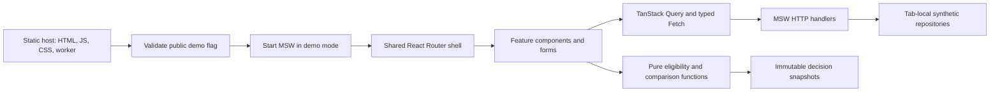

# Architecture

Benefits Decision Explorer is a client-side React application with feature-owned domain contracts and a mocked HTTP boundary. Its fictional rules engine can be imported without React. The static demonstration is independent of ITO Health and has no production backend.

## Ownership and boundaries

`src/app` owns providers, routing, layout and demo configuration/reset controls. `src/components/ui` contains the existing shadcn-style primitives; common layout elements remain reusable presentation. Patient, eligibility, policy, task and coverage features own their schemas, APIs, hooks, components and pages. `src/mocks` owns deterministic fixtures, handlers and browser/Node worker adapters. `src/lib/api` validates responses and exposes lightweight error/retry types. No parallel eligibility implementation or global state framework exists.

Forms use React Hook Form plus Zod; domain rules and date/income calculations remain outside components. HTTP responses are validated at the boundary. Query keys include identifiers, filters, dates and pagination; mutation replies replace authoritative detail data after canceling older reads. Invalidation targets owning lists/derived metadata. Caching, retries and freshness polling are documented in the performance audit.

Screening captures reviewed source/context/policy/results. Simulations modify a hypothetical context without patient writes. Policy comparisons evaluate the same population/date twice with selected versions, preserve snapshots and mark old results outdated. Missing values never silently become zero. Task status, coverage period status and renewal stages use separate domain models and validations.

## Demo lifecycle

`VITE_DEMO_MODE` is public build-time configuration, validated during configuration/startup. Development defaults to demo mode; ordinary production defaults to false. The demo build uses `.env.demo` and rejects a false override. Bootstrap waits for absolute `/mockServiceWorker.js` at root scope before rendering React. MSW logging is quiet; no debug panel is exposed. Repositories live in the browser client, not persistent worker storage or a server.

Reset is a confirmed POST to the mock HTTP layer. It recreates deterministic patient/household/coordinator/task/coverage/event fixtures and replaces request-deduplication maps. The UI waits for active saves, cancels reads, waits for a validated reset response, clears query/mutation caches and reloads to `/dashboard`. Reloading clears every draft, simulator baseline and analysis snapshot. A one-navigation unload bypass respects the explicit discard confirmation; normal guards remain in place. A URL flag carries only completion feedback, not patient data. Other tabs remain independent.

## Tradeoffs and limits

Major feature pages remain lazy-loaded. Demo controls are lazy so the non-demo shell does not eagerly load Zod/form code. A public standalone demo necessarily ships MSW and synthetic repositories in additional chunks; a smaller entry chunk does not imply less total startup work. Data is paginated except bounded population/timeline analysis endpoints. This dataset does not justify a worker or virtualizer.

There is no authentication, shared database, cross-device synchronization, real benefits integration, enrollment engine, notification delivery or immutable audit log. Header identity/notifications, Dashboard and Settings remain placeholders. A lost tab/reload loses mutations. Tests demonstrate frontend behavior and fictional domain conventions; they do not certify healthcare readiness or regulatory compliance.
